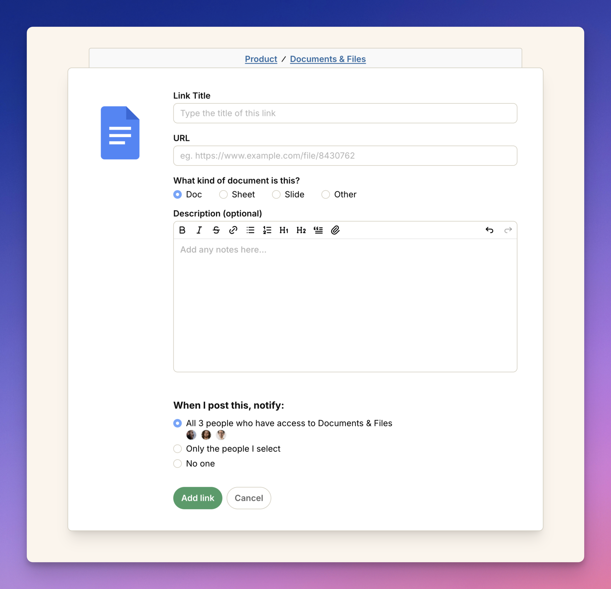

import ImageEnhancer from '@/components/ImageEnhancer.astro';
import { Steps } from '@astrojs/starlight/components';

<ImageEnhancer />

You need Edit access to the space to add an external link.

To add a link:

<Steps>
1. Open the space where you want to share the link.
2. Open the Resource Hub where you want to add the link.
3. Click the **Add** button in the top left corner.
4. Select **Add link**.
5. Choose the service you want to link to or choose **Other** to add a custom link.
6. Enter a name for the link, the URL, and add an optional description.
7. Click **Add link** to save.
</Steps>

Members of the space will be notified that a new file was added.
