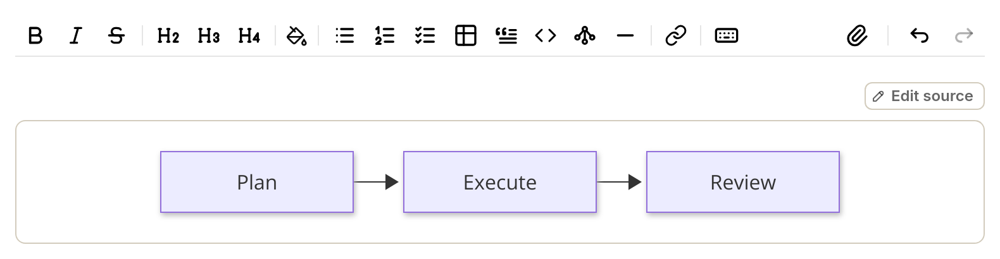
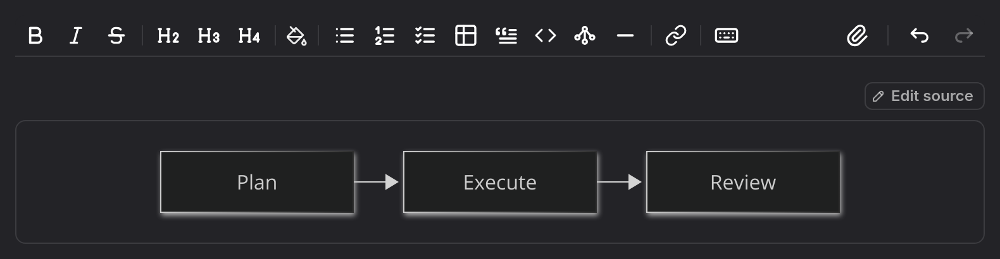

import { Steps } from '@astrojs/starlight/components';
import ImageEnhancer from '@/components/ImageEnhancer.astro';

<ImageEnhancer />

Use Mermaid to turn text into a diagram, such as a flowchart that shows how work moves from planning to review. You can add diagrams to new or existing documents and other places that use Operately’s [rich text editor](/help/format-document-text), such as descriptions, discussions, and comments.

## Insert a diagram from the toolbar

<Steps>
1. In the body of the document, place your cursor on an empty line where you want the diagram.
2. Click **Insert diagram**, the icon with connected dots in the editor toolbar. If you use the compact toolbar, open **More formatting options** first.
3. Type or paste your Mermaid source into the block. If you use the example below, copy just the two lines starting with `flowchart LR`.
4. Click **Preview** to see the diagram.
</Steps>

## Paste a complete Mermaid block

Copy the whole example below, including the opening and closing backticks. Paste it on an empty line in the document body with **Ctrl+V** or **Cmd+V**. Operately inserts the block and shows the diagram preview.

````text

````

## Start a diagram by typing

At the start of an empty line, type `` ```mermaid `` and press **Space**. Enter the diagram source in the block that opens, then click **Preview**.

## Edit and preview a diagram

While editing the document, click **Edit source** above the diagram to change its Mermaid text. Click **Preview** to see the result, then save your document.

If Operately shows **This diagram could not be rendered.**, correct the source shown in the editor and click **Preview** again. Operately uses standard Mermaid syntax. For more diagram types and examples, see the [Mermaid syntax reference](https://mermaid.js.org/intro/syntax-reference.html).

## Light and dark mode

By default, diagram previews follow your [Operately appearance setting](/help/set-light-dark-mode).





For implementation details, see the [Mermaid support pull request](https://github.com/operately/operately/pull/5819).
