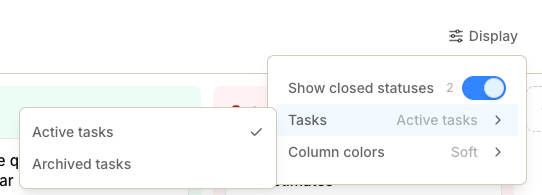

import { Steps } from '@astrojs/starlight/components';
import ImageEnhancer from '@/components/ImageEnhancer.astro';

<ImageEnhancer />

With edit access, you can archive a closed task on an active project or space board. If the task is still open, move it to a closed status first.

## Archive a closed task

<Steps>
1. Open **Tasks** in board layout (in a project) or open the named board (in a space).
2. Open the closed task and choose **Archive**.
3. Confirm with **Archive task**.
</Steps>

## Find and restore a task

<Steps>
1. On the same board, open **Display** → **Tasks** → **Archived tasks**.
2. Open the task and choose **Restore to board**.
3. Switch back to **Active tasks**.
</Steps>

Restored tasks keep their closed status. If the column is hidden, turn on **Show closed statuses** in **Display**.

To archive or restore an entire board, see [Space Tools](/help/space-tools).
