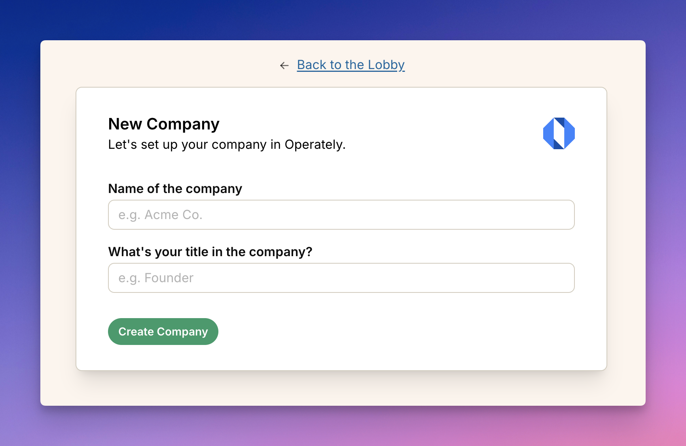
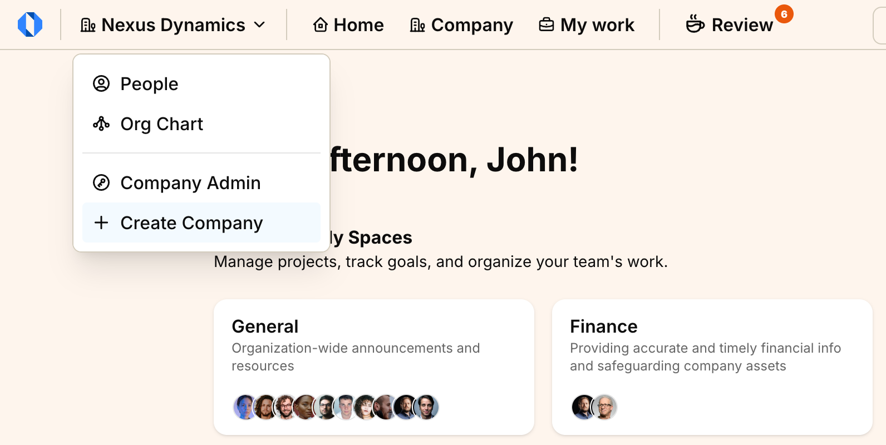

import ImageEnhancer from '@/components/ImageEnhancer.astro';
import { Steps } from '@astrojs/starlight/components';

<ImageEnhancer />

You can create a new organization in Operately either as a new user or when you're already using the system with another organization.

### Creating your first organization

When you sign up for Operately for the first time, you'll automatically be prompted to create a new organization:

<Steps>

1. If you have no company memberships, choose **Create Company** in the lobby.

2. Enter your company name in the **Name of the company** field.

3. Enter your job title in the **What's your title in the company?** field.

4. Click the **Create Company** button to set up your organization.

</Steps>

Your new organization will be created instantly, and you'll be taken to the company Work Map to **Add your first project**.

### Creating additional organizations

With one membership, signing in opens your company directly. Click your company name in the navigation and choose **Create Company**.

With multiple memberships, reach the lobby from the company menu, then create the company:

<Steps>

1. Click your company name in the navigation to open the company menu.

2. Choose [**Switch Company**](/help/switch-organization-account).

3. Choose **Create Company** in the lobby.

4. Enter the new company name in the **Name of the company** field.

5. Enter your job title in the **What's your title in the company?** field.

6. Click the **Create Company** button.

</Steps>

## What happens next

After creating your organization:

- You'll automatically become the organization's owner
- A default **General** [space](/help/intro-to-spaces) will be created
- You can immediately start inviting team members
- You can customize your organization structure by [creating additional spaces](/help/create-space)

Now that your organization is set up, consider [inviting team members](/help/invite-team-member) to get started collaborating.
