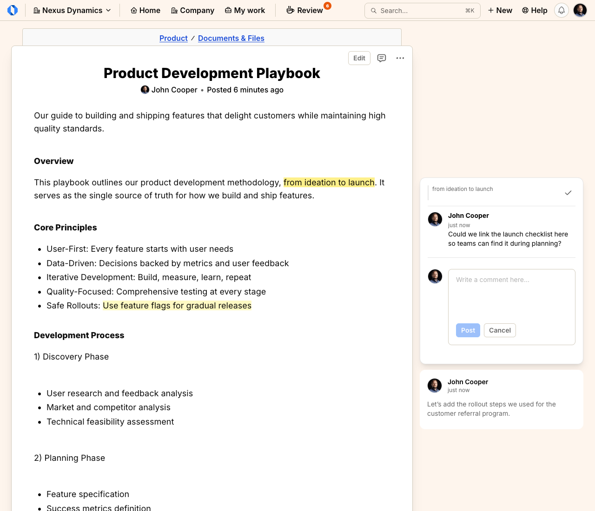

import { Steps } from '@astrojs/starlight/components';
import ImageEnhancer from '@/components/ImageEnhancer.astro';

<ImageEnhancer />

Use inline comments to discuss specific text in a document.

## Start a thread

<Steps>
1. Open the document.
2. Select the text you want to discuss and choose **Add comment**.
3. Write your message and click **Post**.
</Steps>

Anyone with View access can read inline comments. You need Comment access to start, reply to, or resolve a thread.

## Read and reply

Click highlighted text to open its thread (beside the document on wide screens, or in the comments panel on narrow screens). Authors can edit or delete their own messages.

Open the comments icon in the header to view **Inline comments**, including **Resolved** threads.

## Resolve or reopen

Choose **Resolve** once feedback is addressed. To continue a resolved thread, find it under **Resolved** and choose **Reopen** before replying or editing a message.

## When the document changes

- If someone edits the document while you're drafting an inline comment, select the text again to post your saved message.
- After an edit or [version restore](/help/document-version-history), highlights follow the commented text where possible. If Operately can no longer locate it, the thread keeps the original quote and shows **This passage is no longer available.**
