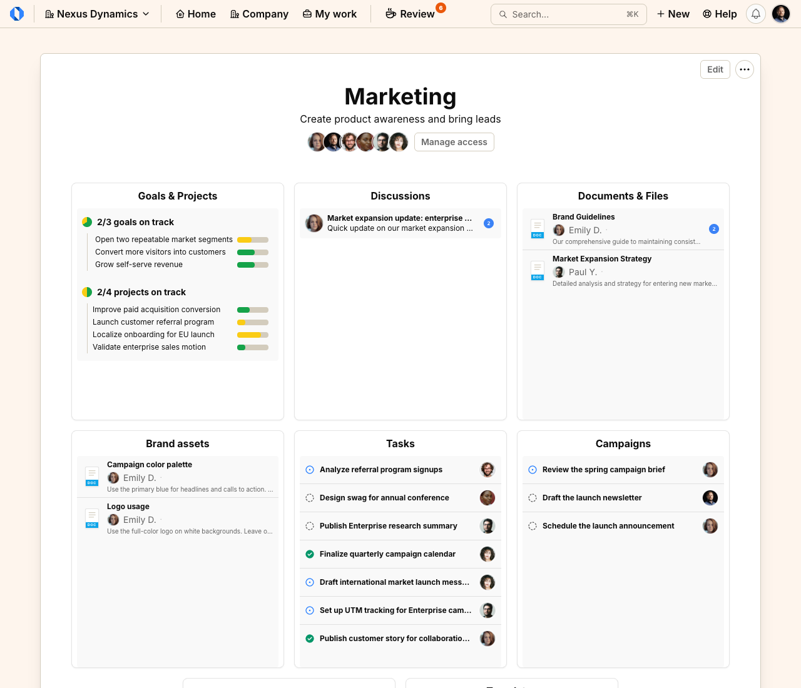

import ImageEnhancer from '@/components/ImageEnhancer.astro';
import { Aside } from '@astrojs/starlight/components';

<ImageEnhancer />

Spaces help you organize work around natural team structures. Think of them as dedicated areas where teams collaborate on their goals and projects.

### Getting started with spaces

For most startups, [create a space](/help/create-space) for each core department:

- Marketing: Brand, growth, and customer acquisition
- Product: Product strategy and development
- Engineering: Technical development and infrastructure
- Customer Success: User onboarding and growth
- Sales: Revenue and business development
- Finance: Budget and financial operations
- People: Hiring and team development
- Legal: Compliance and contracts

As your company grows, you might create more specific spaces like "Enterprise Sales" or "Platform Engineering" to match your evolving organization.

### What you'll find in each space

A space can show these tools on its page:

- **Work Map**: Visualize goals and projects in a hierarchical view that shows how work connects and progresses
- **Discussions**: Share updates and have focused team conversations
- **Task boards**: Organize space tasks by status—open any board by name
- **Resource Hubs**: Store documents, drafts, folders, files, and links (the default hub starts as **Documents & Files**)
- **KPIs**: Track standing metrics for the team and log updates over time. See [Introduction to KPIs](/help/intro-to-kpis).

Space editors can [add, rename, reorder, or hide space tools](/help/space-tools).

Each space has its own Work Map that shows the goals and projects specific to that team. You can see how work connects, track progress, and plan new initiatives all in one view. For a complete overview of how Work Maps work, see [Introduction to Work Maps](/help/work-map-overview).

### The Company space: Your central HQ

The Company space comes built-in and serves as your organization's shared home. Use it for:
- Company-wide announcements
- Cross-team initiatives
- Strategic planning
- Documentation that everyone needs

### Visibility and access

Spaces are open by default — anyone in your company can view and comment what's happening. This promotes collaboration and keeps everyone informed.

Need privacy for sensitive work? You can make any space private using [access management tools](/help/space-access-control).

Click **Join this Space** on any space you can open to add yourself to the member list.

### Adding team members

Add people who actively work on your team's initiatives. They'll get notifications about:

- New goals and projects
- Team discussions
- Important documents
- Project updates
- KPI updates, if they subscribe or champion a [KPI](/help/intro-to-kpis)

<Aside>People don't need to be added to a space to view its content (unless it's private). This keeps information flowing while keeping notifications focused on relevant team members.</Aside>
