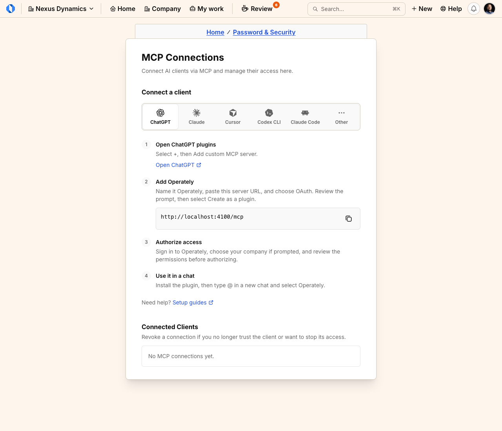
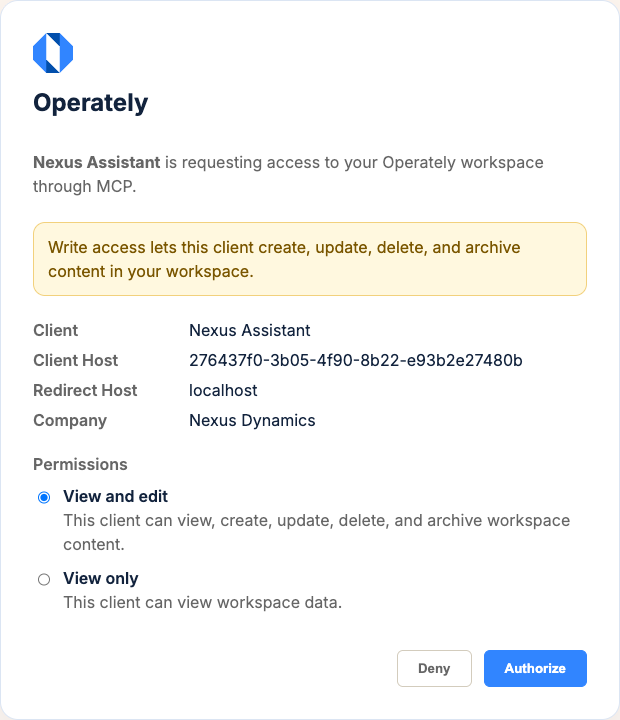

import { Aside, Steps } from '@astrojs/starlight/components';
import ImageEnhancer from '@/components/ImageEnhancer.astro';

<ImageEnhancer />

Use MCP (Model Context Protocol) to connect an AI client such as Claude, ChatGPT, or Cursor to Operately. After you authorize the client, it can search and work with the goals, projects, tasks, and documents you already have access to.

MCP is separate from [API tokens](/help/create-api-token) and the [CLI](/help/cli). Each MCP connection is tied to one company. To use a different company, connect the client again and choose that company.

## How to get there

Open your avatar menu → **MCP Connections** → **Connect a client**.

## Connect a client

<Steps>
1. Under **Connect a client**, select your client.
2. Follow the setup instructions shown—copy the server URL (see [ChatGPT](/help/mcp-chatgpt) or [Claude](/help/mcp-claude)), or use the provided configuration or commands.
3. Sign in to Operately and select the company if prompted.
4. Check **Client**, **Company**, and **Permissions**. Select the access you want and click **Authorize**, or choose **Deny** to cancel.
</Steps>

For a client that accepts a URL, **Other** offers **Copy server URL**. Operately Cloud uses `https://app.operately.com/mcp`; self-hosted installations use your own instance URL (e.g. `https://work.example.com/mcp`).

## Permissions

**View and edit** is preselected when a client requests both permissions or leaves them unspecified. Choose **View only** to restrict the client to reading—your workspace permissions still apply.

Check **Connected Clients** to see each client's grant under **Access** (**View only**, **Edit only**, or **View and edit**).

## What you can ask

- **View access:** *"Which of my tasks are open?"*
- **Write access:** *"Log this week's KPI value as 42 for qualified leads."*

## Review connected clients

The **Connected Clients** section lists your active authorizations for the current company. Revoked connections are no longer listed. Revoke a connection if you no longer trust the client or want to stop its access.

Each row shows:

- **Client**
- **Access**
- **Connected**
- **Last Used**

If you have not authorized any clients yet, the page shows **No MCP connections yet.**

<Aside type="note">
A listed connection does not prove that your client has current credentials. If it stops working, see [Troubleshoot an MCP connection](/help/troubleshoot-mcp-connection).
</Aside>

## Revoke a connection

Revoking immediately stops that client's access. The client must reconnect through OAuth before it can use Operately again.

<Steps>
1. Open **MCP Connections**.
2. In the **Connected Clients** table, open the menu on the client row.
3. Click **Revoke**.
4. On the **Revoke connection** dialog, click **Revoke**. Click **Cancel** to keep the connection.
</Steps>

The confirmation asks: *Revoke access for [client name]? The client will need to reconnect through OAuth.*

## What to read next

- [Connect ChatGPT](/help/mcp-chatgpt)
- [Connect Claude](/help/mcp-claude)
- [Review or revoke a connection](/help/mcp-revoke-connection)
- [How permissions work](/help/permissions-overview)
- [Create an API token](/help/create-api-token)
- [Operately CLI overview](/help/cli)
- [Use Operately with OpenClaw](/help/use-with-openclaw)
- [Operately API docs](/help/api)
