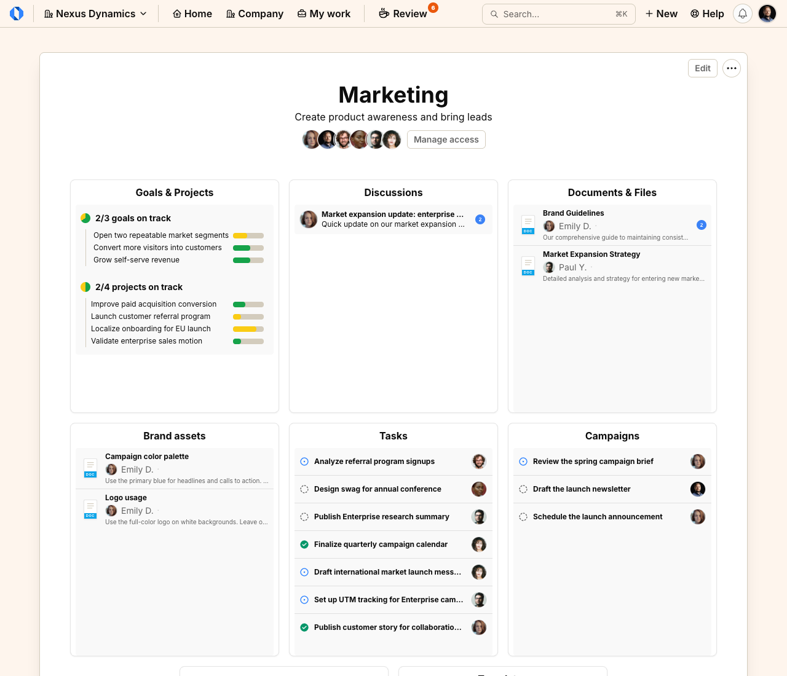
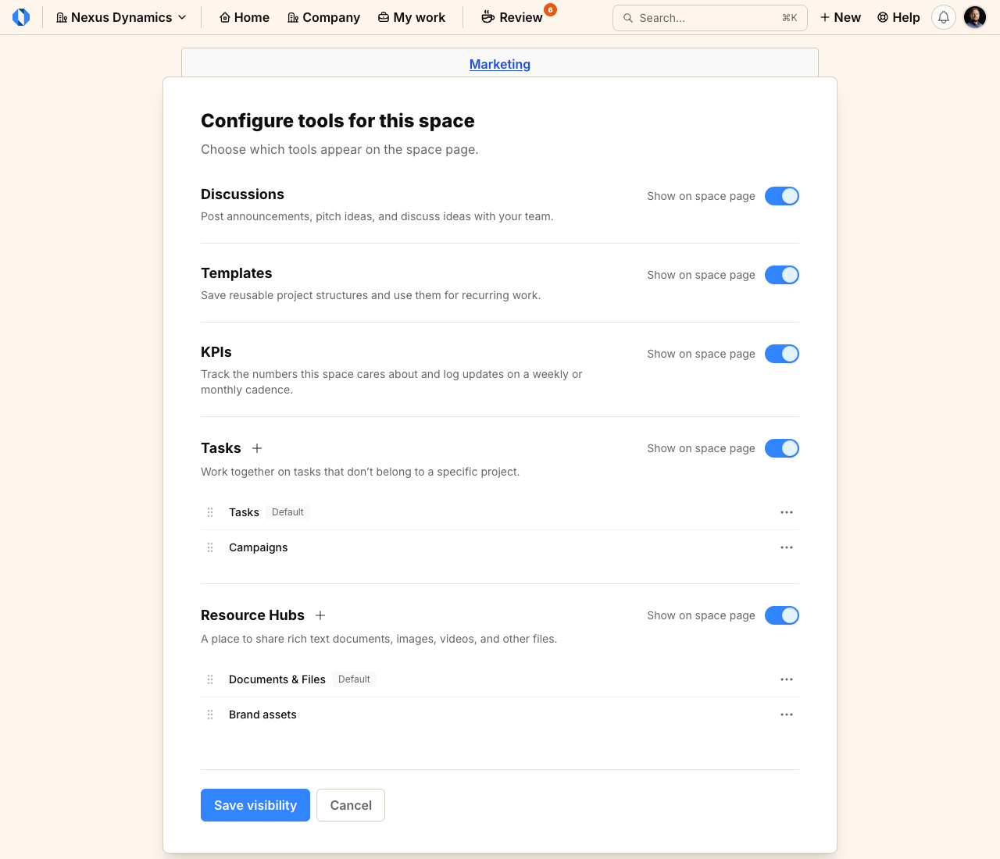

import { Steps } from '@astrojs/starlight/components';
import ImageEnhancer from '@/components/ImageEnhancer.astro';

<ImageEnhancer />

A space can have multiple task boards and Resource Hubs. Open any board or hub from the space page.

## Manage boards and Resource Hubs

With Edit access to the space, add a new board or hub:

<Steps>
1. Open the space menu (**...**) and choose **Configure tools**.
2. Under **Tasks** or **Resource Hubs**, click **New board** or **New Resource Hub**.
3. Enter a **Name** and click **Create**.
</Steps>

From **Configure tools**, you can also:

- **Rename**: Open that board's or hub's menu and choose **Rename**.
- **Reorder**: Drag a row by its handle within its category.
- **Hide or show a category**: Toggle **Show on space page** and click **Save visibility**. Hidden tools keep their contents.

Changes to names, order, and new tools take effect immediately.

## Set the default board

Each board keeps its own statuses and task order. Open a board's row menu and choose **Set as default**. Tasks created without a specific board go to the default board. Reordering boards does not change the default.

## Archive or restore a board

Open a board's row menu, choose **Archive**, and confirm. To archive the default board, make another active board the default first. Existing links still open archived boards, and their tasks keep their statuses.

To bring a board back for active work, open **Archived boards** and choose **Restore**. To archive a single closed task instead, see [Archive and restore tasks](/help/archive-and-restore-tasks).

## Delete a Resource Hub

You can delete any empty hub except the default. Remove all contents first—including folders and drafts. Then, choose **Delete** from the hub's row menu and confirm.

## Available Tools

- **Resource Hubs**: Store documents, folders, files, and links.
- **Discussions**: Post announcements, pitch ideas, and discuss topics with your team.
- **Tasks**: Group the space's task boards for work outside a project.
- **Templates**: Save reusable project structures for recurring work. See [Project templates](/help/project-templates).
- **KPIs**: Track key metrics for the space on a weekly or monthly cadence. See [Introduction to KPIs](/help/intro-to-kpis).

See [Introduction to Spaces](/help/intro-to-spaces) for how people join a space and find its tools.
