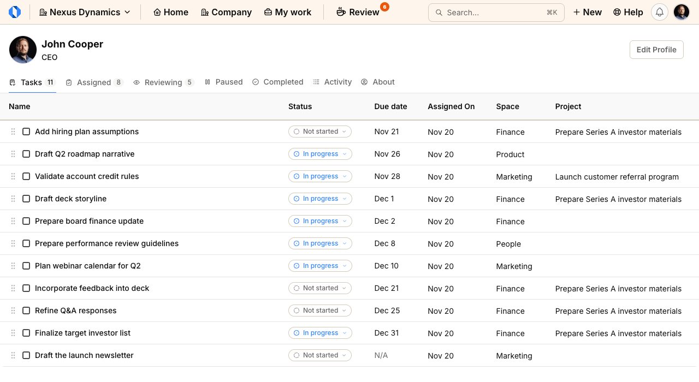

import { Aside } from '@astrojs/starlight/components';
import ImageEnhancer from '@/components/ImageEnhancer.astro';

<ImageEnhancer />

In the navbar, open **My Work** and choose **Tasks** to see all tasks assigned to you across projects and spaces.

## What you'll see in the Tasks tab

The Tasks tab displays your assigned tasks in a table format, showing:

- **Name** — The title of the task
- **Status** — Current state of the task (e.g., Todo, In Progress)
- **Due Date** — When the task should be finished
- **Assigned On** — When the task was assigned to you
- **Space** — Which team or department owns the task
- **Project** — The project the task belongs to (if applicable; space tasks don't have a project)

## Managing your tasks

From the list, you can:

- **Drag tasks** into the order you want to work on them
- **Click a status** to update it inline (requires Edit access)
- **Click a task name** to open its details and comments
- **Click a project or space name** to jump to its workspace

<Aside>The Tasks tab aggregates tasks from all your projects and spaces, giving you a single place to see what you need to do.</Aside>
